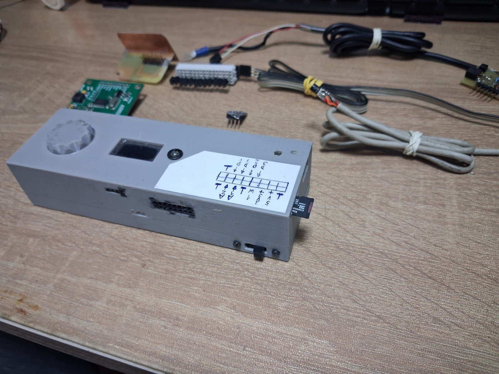
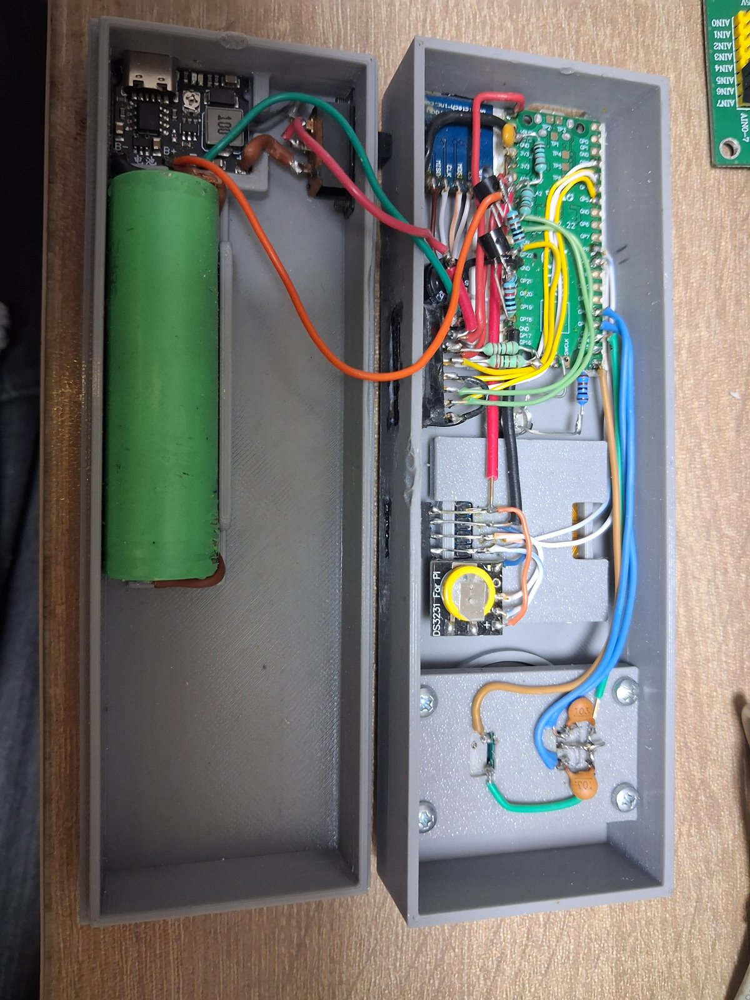
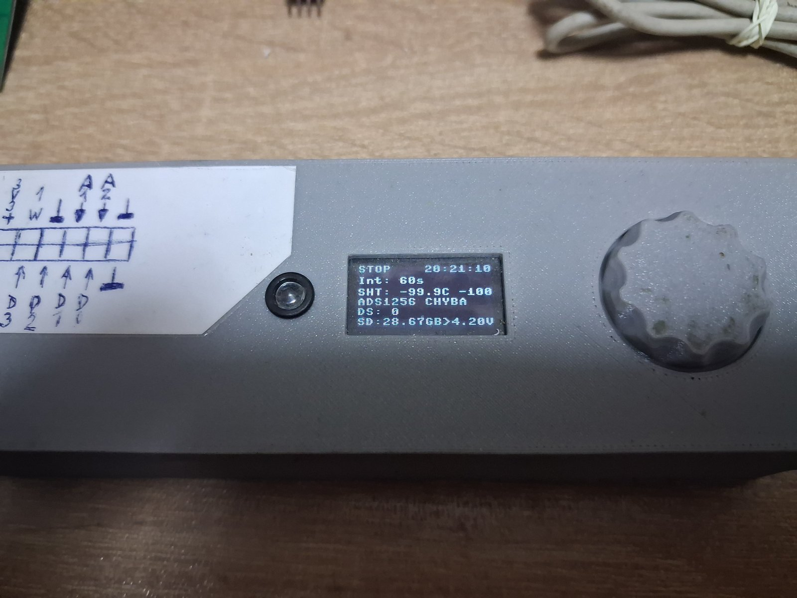

# Multi-Channel DataLogger (RPi Pico)

Tento projekt predstavuje robustný amatérsky datalogger postavený na mikrokontroléri Raspberry Pi Pico. Zariadenie monitoruje teplotu, vlhkosť, analógové napätia, binárne vstupy a stav batérie.

## 📷 Prvá verzia zariadenia

Prvá fyzická verzia dataloggera v kryte s OLED displejom a rotačným
ovládačom. Fotografie ukazujú hotovú zostavu, vnútorné zapojenie a
pripojenie externého modulu ADS1256.



| Vnútorné zapojenie | OLED displej |
|---|---|
|  |  |

[Kompletná galéria prvej verzie zariadenia](docs/photos/v1/README.md)
obsahuje aj ďalšie pohľady a externý modul ADS1256. Fotografie dokumentujú
prototyp; aktuálne zapojenie je uvedené v hardvérovej dokumentácii.

## 🚀 Kľúčové vlastnosti

- **Meranie prostredia:** SHT4x pre teplotu a relatívnu vlhkosť.
- **Viacbodové meranie teploty:** viacero senzorov DS18B20 na zbernici OneWire.
- **Analógové vstupy:** dva ADC vstupy 0–3,3 V.
- **Monitorovanie batérie:** meranie napätia batérie cez samostatný ADC vstup; táto časť hardvéru a firmware je stále vo vývoji.
- **Binárne vstupy:** štyri digitálne vstupy pre sledovanie logických stavov.
- **Záznam dát:** ukladanie meraní vo formáte CSV na microSD kartu.
- **Používateľské rozhranie:** SSD1306 OLED displej a rotačný enkodér s tlačidlom.
- **Presný čas:** externý RTC DS3231 synchronizovaný s interným RTC Raspberry Pi Pico.

## ADS1256 – výber vstupov enkodérom

Pri vypnutom logovaní (PAUZA) vyberte položku **ADS1256** vedľa SyncRTC
a TEST. Stlačením otvorte podmenu, otočením vyberte **On/Off** a ďalším
stlačením potvrďte. **On** zapne čítanie AN0–AN7, **Off** obnoví pôvodné
dva analógové a štyri digitálne vstupy. Zmena platí ihneď bez reštartu;
počas REC nie je dostupná. Po reštarte sa obnoví predvolený stav On.
Oba režimy používajú spoločné GPIO; zapojenie J3 musí zodpovedať režimu.

Podmenu **ADS1256 → Vzorky** umožňuje zvoliť 1, 2, 4, 8, 16 alebo 32
vzoriek na kanál. Displej aj CSV používajú aritmetický priemer; vyšší počet
predlžuje čas aktualizácie. Predvolene je 1 (bez priemerovania).

Cez Thonny nahrajte aktualizovaný `main.py` a súbory `ads1256.py`,
`adc_average.py`, `logger_csv.py`. Ovládanie a oba CSV formáty sú vo
[`firmware/README.md`](firmware/README.md). Nižšie uvedená tabuľka GPIO
a pôvodná CSV hlavička opisujú režim ADS1256 Off.
Prepínanie ADS1256 On/Off cez rotačný enkodér bolo odskúšané na Pico
a používateľ potvrdil jeho funkčnosť 19. 10. 2026.

## 🛠 Hardvérová konfigurácia
| Komponent            | Pin (GP)            | Funkcia                             |
|----------------------|---------------------|-------------------------------------|
| I2C0 (SDA/SCL)       | 8 / 9               | OLED, RTC DS3231, SHT4x             |
| SPI0 (SCK/MOSI/MISO) | 18/19/16            | SD Karta                            |
| SD Card CS           | 17                  | Chip Select pre SD                  |
| OneWire (DS18B20)    | 22                  | Teplotné senzory                    |
| Rotačný enkodér      | 12 (CLK), 13 (DT)   | Ovládanie menu (IRQ)                |
| Tlačidlo enkodéra    | 15                  | Prepínanie režimov (Pauza/REC/Test) |
| Binárne vstupy       | 2, 3, 4, 5          | Digitálne vstupy (Pull-up)          |
| ADC Vstupy           | 26, 27              | Analógové meranie                   |
| Battery Monitor      | 28 (ADC), 21 (CTRL) | Meranie batérie cez tranzistory     |
| Stavová LED          | 14                  | Signalizácia zápisu a chýb          |

## 📁 Štruktúra projektu

- `firmware/` — MicroPython firmware pre Raspberry Pi Pico
- `hardware/schematic/` — KiCad projekt, schéma, PCB a lokálne knižnice
- `hardware/enclosure/` — podklady pre mechanickú konštrukciu
- `docs/data/` — ukážkové namerané dáta
- `docs/datasheet/` — technická dokumentácia použitých komponentov

Podrobnosti o firmware sú v [`firmware/README.md`](firmware/README.md).

Dokumentácia hardvéru a KiCad projektu je v
[`hardware/schematic/README.md`](hardware/schematic/README.md).

## ⚙️ Prevádzkové režimy

- **PAUZA** — zariadenie vykonáva merania a zobrazuje aktuálne hodnoty, ale nezapisuje ich na SD kartu. Enkodérom je možné zvoliť režim alebo interval záznamu.
- **REC** — namerané údaje sa ukladajú na SD kartu v nastavenom intervale. Pre každý záznam sa vytvorí nový CSV súbor s názvom `YYYYMMDD_HHMMSS.csv`.
- **TEST** — umožňuje prechádzať pripojené DS18B20 senzory a zobrazovať ich ROM ID a aktuálnu teplotu.
- **SYNC RTC** — synchronizuje externý RTC DS3231 s aktuálnym časom interného RTC Raspberry Pi Pico.

Interval záznamu je možné nastaviť od 5 do 300 sekúnd v krokoch po 5 sekúnd.

Podrobný popis ovládania a režimov je v
[`firmware/README.md`](firmware/README.md).

## 💾 Formát dát (CSV)

Pri spustení režimu **REC** sa vytvorí nový CSV súbor s názvom odvodeným
od aktuálneho dátumu a času. Do rovnakého súboru sa zapisuje až do
ukončenia režimu REC.

Pevná časť CSV hlavičky je:

```text
Cas,SHT_T,SHT_H,A1,A2,BAT,BIN,B1,B2,B3,B4
```
Za ňou firmware pridá ROM ID jednotlivých detegovaných DS18B20 senzorov
ako ďalšie stĺpce.
Príklad nameraných dát je v adresári [`docs/data/`](docs/data/).

## 🛡 Stabilita záznamu

- **Obsluha enkodéra cez IRQ:** enkodér je spracovávaný pomocou prerušenia.
- **Zápis na SD kartu:** po zápise dát firmware používa `flush()` a `uos.sync()` na prenesenie dát do súborového systému.
- **Správa pamäte:** firmware pravidelne používa garbage collection (`gc.collect()`).

## 🔌 Zapojenie

Detailné elektrické zapojenie je dostupné v KiCad projekte v
[`hardware/schematic/`](hardware/schematic/).

### 1. I2C zbernica (GP8, GP9)

Na spoločnej I2C zbernici sú pripojené:

- OLED displej SSD1306
- RTC DS3231
- senzor teploty a vlhkosti SHT4x

SDA a SCL vyžadujú pull-up rezistory. Pri použití hotových modulov je
potrebné overiť, či ich už moduly obsahujú.

### 2. microSD karta (SPI0)

microSD karta komunikuje s Raspberry Pi Pico cez SPI0:

| Signál | GPIO |
|---|---:|
| SCK | GP18 |
| MOSI | GP19 |
| MISO | GP16 |
| CS | GP17 |

Komunikačné signály microSD karty pracujú s logickými úrovňami 3,3 V.

### 3. OneWire (GP22)

DS18B20: Všetky senzory paralelne (Data na GP22, VCC na 3.3V, GND).
Pull-up: Medzi GP22 a 3.3V musí byť odpor 4.7kΩ.

### 4. Monitorovanie batérie

Napätie batérie sa meria pomocou ADC na GP28, pričom GP21 slúži na
ovládanie meracieho obvodu.

Hardvérové zapojenie a spôsob merania batérie sú stále vo vývoji a môžu
sa zmeniť. Aktuálne zapojenie je zdokumentované v KiCad schéme.

### 5. Ovládacie prvky

- **Enkodér:** CLK na GP12, DT na GP13; 10 nF kondenzátory slúžia na filtráciu zákmitov.
- **Tlačidlo enkodéra:** GP15, aktívne zopnutím proti GND s interným pull-up rezistorom.
- **Stavová LED:** GP14 cez 220 Ω rezistor.

## Verziovanie a vydania

Prvé označené vydanie: **v1.0.0**. Firmvér pri štarte vypisuje verziu
z Git tagu, krátke SHA, počet commitov a prípadné označenie `dirty`.
Balík na PC pripravíte z koreňa projektu:

```bash
python3 tools/prepare_firmware.py
```

V Zede možno použiť úlohu **Verzia: pripraviť firmvér** cez
Ctrl+Shift+P → `task: spawn` (na tomto PC je nastavená globálne).
Príprava vytvára `work/firmware/`; nepublikuje vydanie ani nenahráva na dosku.
Podrobný postup prípravy, prenosu a skúšky je vo
[firmware/README.md](firmware/README.md#verzia-firmvéru-z-gitu).
Zmeny vydaní sú v [CHANGELOG.md](CHANGELOG.md).

## 📄 Licencia

Tento projekt je licencovaný pod [GNU GPL v3](LICENSE).
