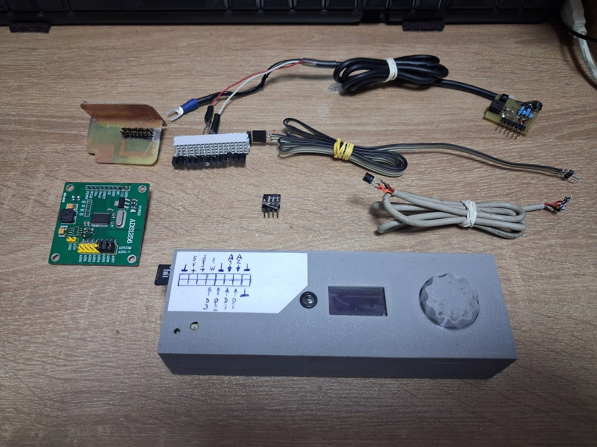
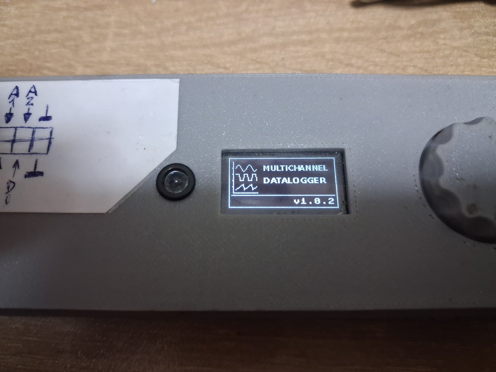
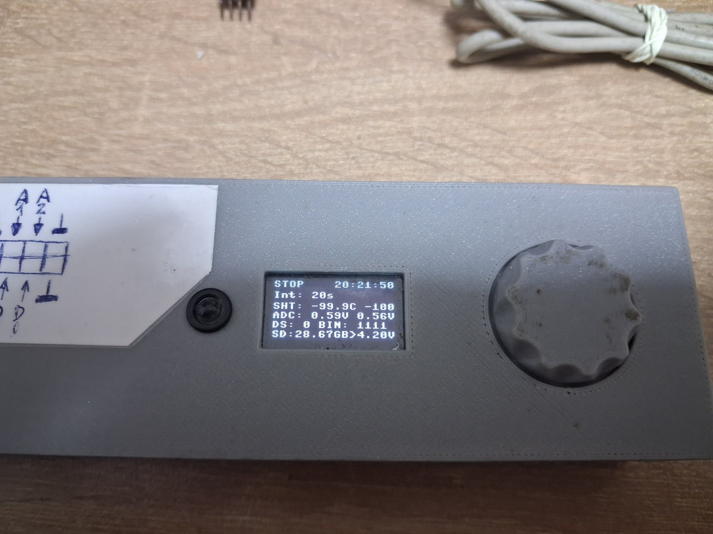
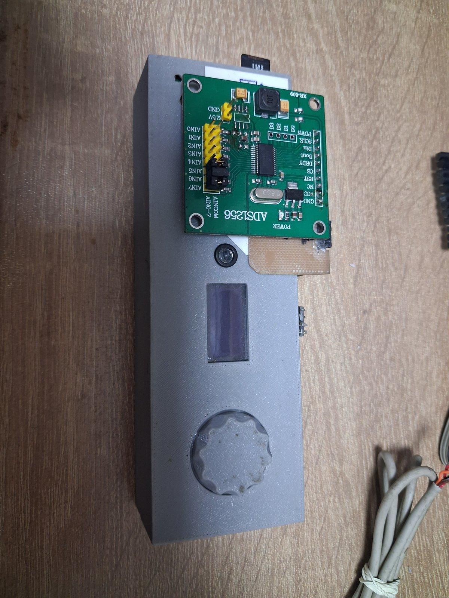
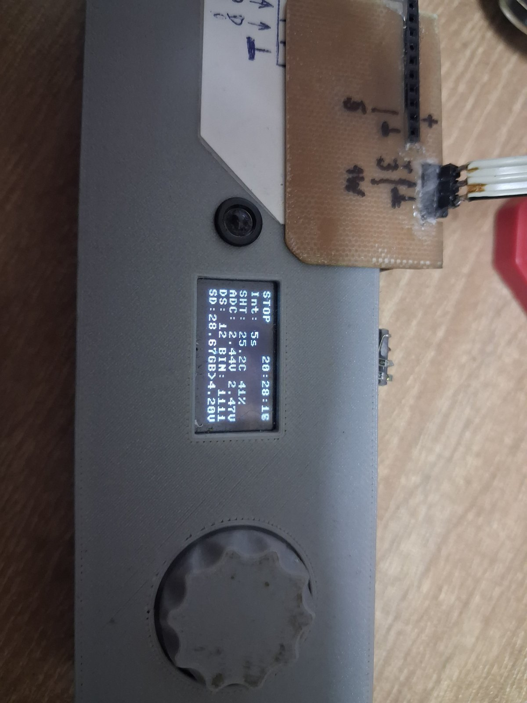

# Fotografie prvej verzie zariadenia

Fotografie zachytávajú prvú fyzickú verziu dataloggera. Ide o dokumentáciu
prototypu; aktuálne zapojenie a funkcie opisujú príslušné časti repozitára.

## Celkový pohľad na prvú verziu zariadenia a príslušenstvo

## Vnútorné usporiadanie prototypu, kabeláž a batéria

## Zariadenie, externé moduly a káblové sondy

## Úvodná obrazovka na OLED displeji

## Zobrazenie údajov na OLED displeji

## Detail ďalšej obrazovky displeja

## Zariadenie s externým modulom ADS1256

## Detail pripojenia externého modulu

